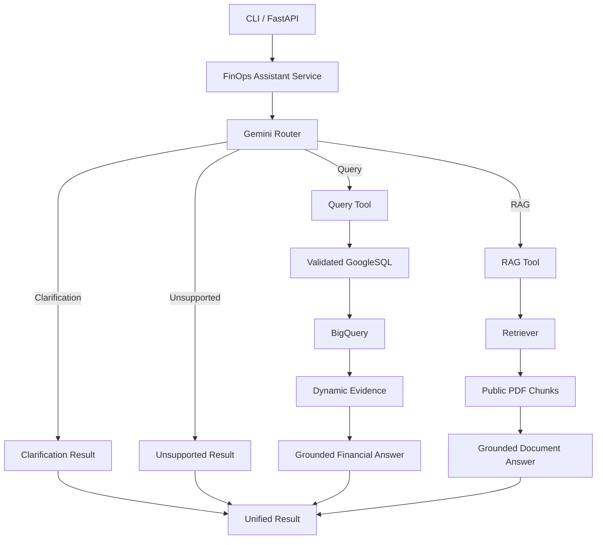

# Data-AI Assistant — FinOps MVP

A beginner-friendly Data and AI assistant for cloud billing analysis.

The project demonstrates a complete learning path:

1. Load and validate a small synthetic cloud billing dataset.
2. Clean, profile, investigate, and store the data.
3. Publish and query the data safely through BigQuery.
4. Convert English financial questions into validated GoogleSQL.
5. Generate financial answers from verified query evidence.
6. Answer FinOps documentation questions through a simple RAG pipeline.
7. Route each user question to the correct Query, RAG, clarification, or unsupported path.
8. Expose the same reusable services through CLI and FastAPI.

## Project Status

The core MVP is functionally complete.

An optional LangGraph demonstration is included to represent the existing
Router, Query, RAG, clarification, and unsupported paths as a small graph.
It reuses the current services and does not replace the main unified CLI
or FastAPI workflow.

A frontend, production deployment, authentication, OCR, advanced agents,
and complex cloud infrastructure remain outside the current MVP scope.

## Final MVP Evidence

| Requirement | Project Implementation |
|---|---|
| Synthetic/public data | Synthetic FOCUS-style billing CSV with 1000 rows and 44 columns |
| Data ingestion and cleaning | Reusable local data pipeline |
| SQL analytics | Local analytical SQL and BigQuery SQL queries |
| Structured LLM output | Pydantic Query Plan, SQL Proposal, Router Decision, and Final Answer contracts |
| Safe BigQuery execution | Local validation, semantic validation, named parameters, Dry Run, and byte limits |
| Simple RAG | Three public FinOps PDF documents with page and chunk sources |
| Routing | Gemini Router selects Query, RAG, clarification, or unsupported |
| Reusable interfaces | Query CLI, RAG CLI, unified CLI, FastAPI, and optional LangGraph demo |
| Evaluation | Manual baseline, reference SQL catalog, and evaluation questions |
| Documentation | Architecture, setup steps, demo questions, logging, and limitations |

## Unified Architecture



The Router classifies the question only. It does not execute SQL, search
documents, or produce the final domain answer.

The Query and RAG tools reuse the existing services and convert their internal
results into one shared response shape.

## Unified Result Contract

The unified CLI, FastAPI endpoint, and optional LangGraph demo return the same
general response shape:

```json
{
  "status": "answered",
  "route": "query",
  "answer": "The total effective cost for Microsoft is 1.98.",
  "sources": [
    {
      "source_type": "bigquery",
      "source_name": "project.dataset.table",
      "location": "US"
    }
  ]
}
```

Supported routes:

- `query`
- `rag`
- `needs_clarification`
- `unsupported`

The business `status` is separate from the HTTP status code.

## Dataset

The repository includes:

```text
data/raw/focus_cloud_billing_sample_1000.csv
```

The file contains:

- 1000 synthetic billing rows.
- 44 columns.
- AWS, Microsoft, and Oracle examples.
- No company or production data.
- No credentials or confidential information.

This CSV is the complete dataset used by the MVP, while still representing a
small training sample compared with real production billing exports.

## Data Pipeline

```text
Raw CSV
  -> Ingestion
  -> Input Validation
  -> Profiling
  -> Cleaning
  -> Cleaning Validation
  -> Analysis
  -> Outlier Investigation
  -> Cleaned CSV
  -> SQLite Reconciliation
  -> BigQuery Staging
  -> BigQuery Reconciliation
  -> Published BigQuery Table
  -> Pipeline Manifest
```

The local path can run without publishing to BigQuery. The cloud path publishes
only after validation and reconciliation succeed.

## FinOps Query Journey

```text
English Financial Question
  -> Safe BigQuery Schema Context
  -> Gemini Query Generation
  -> Structured Query Plan
  -> GoogleSQL Proposal
  -> Pydantic Contract Validation
  -> Query Plan Validation
  -> SQL Safety Validation
  -> SQL Semantic Validation
  -> BigQuery Named Parameters
  -> BigQuery Dry Run
  -> Optional Real Execution
  -> Query Result Validation
  -> Dynamic Evidence
  -> Grounded Final Answer
  -> Final Answer Validation
```

Gemini proposes the Query Plan and GoogleSQL. The backend remains responsible
for validation, execution decisions, BigQuery access, result validation, and
evidence construction.

### Query Components

| File | Responsibility |
|---|---|
| `models.py` | Defines structured contracts used across the Query journey |
| `schema.py` | Reads the BigQuery schema and builds a safe semantic context |
| `query_service.py` | Generates and validates the Query Plan and GoogleSQL |
| `bigquery_service.py` | Binds parameters, performs Dry Run and execution, validates results, and builds Dynamic Evidence |
| `answer_service.py` | Generates and validates the evidence-grounded final answer |
| `assistant_service.py` | Coordinates the complete Query journey |

### Supported Metrics

- `billed_cost`
- `effective_cost`
- `negative_billed_cost`

### Supported Dimensions

- `provider`
- `service`
- `currency`

### Supported Operations

- Sum
- Average
- Minimum
- Maximum
- Supported count operations
- Provider, service, and currency filters
- Supported date ranges
- Grouping
- Ascending and descending sorting
- Result limits

### Query Safety

Before execution, the backend checks that SQL:

- Contains one read-only `SELECT` statement.
- Uses the configured allowed BigQuery table.
- Uses only allowed physical columns.
- Does not use unsupported DML or DDL.
- Does not use unsupported joins, CTEs, subqueries, or window functions.
- Does not use `SELECT *`.
- Uses named parameters for user-provided values.
- Defines exactly the parameters referenced by SQL.
- Matches the metrics, dimensions, filters, date range, sorting, and limit in the Query Plan.
- Applies the negative-cost condition when required.
- Remains within the configured BigQuery byte limit.
- Includes a result limit for grouped queries.

After execution, the backend checks that:

- Returned columns match the Query Plan.
- Row counts remain within the allowed limit.
- Metric values are finite numbers or `null`.
- Dynamic Evidence contains only verified BigQuery results.
- Evidence references point to real rows and columns.
- Financial numbers in the final answer exist in the question or referenced evidence.

## FinOps RAG Journey

```text
Public PDF Documents
  -> Page Text Extraction
  -> Text Normalization
  -> Chunking with Metadata
  -> Document Embeddings
  -> Local RAG Index
  -> Question Embedding
  -> Cosine Similarity
  -> Top-K Retrieval
  -> Grounded Gemini Answer
  -> Answer with Sources
```

The complete PDF documents are not sent to Gemini. Only the most relevant
retrieved chunks are included in the answer prompt.

Each source may include:

- PDF filename
- Page number
- Chunk ID
- Official source URL
- Similarity score

If the retrieved context does not contain enough evidence, the RAG assistant
returns `not_found` instead of forcing an unsupported answer.

The PDF documents are downloaded from official public sources and are not
committed to the repository. See:

```text
data/rag_documents/README.md
```

The current document set includes:

1. A public FOCUS document.
2. A public Microsoft Azure FinOps document.
3. A public Google Cloud FinOps shared-services document.

Scanned or image-only PDFs require OCR and are outside the current MVP.

## Router and Tool Layer

| Component | Responsibility |
|---|---|
| `router.py` | Classifies the question as Query, RAG, clarification, or unsupported |
| `service.py` | Calls the selected tool and returns one unified result |
| Query Tool | Wraps the existing Query Assistant Service |
| RAG Tool | Wraps the existing RAG Assistant Service |

The tool wrappers do not duplicate the internal Query or RAG logic.

## Model Calls

### Unified Query Question

1. Router call selects `query`.
2. Query-generation call returns the Query Plan and GoogleSQL Proposal.
3. Final-answer call converts verified Dynamic Evidence into a natural-language answer.

### Unified RAG Question

1. Router call selects `rag`.
2. The embedding model converts the question to a vector.
3. The answer model generates a grounded answer from retrieved chunks.

Embedding generation is separate from natural-language answer generation.

## Optional LangGraph Demonstration

The optional LangGraph workflow represents the existing assistant as:

- State
- Nodes
- Edges
- Conditional Edges

It reuses the existing Router, Query Tool, RAG Tool, clarification result, and
unsupported result.

It does not:

- Replace the main Assistant Service.
- Add another Gemini call.
- Add an autonomous agent.
- Add streaming or checkpoints.
- Duplicate the Query or RAG journeys.

## Project Structure

```text
.
├── data/
│   ├── raw/
│   │   └── focus_cloud_billing_sample_1000.csv
│   ├── processed/                 # Generated locally, ignored by Git
│   ├── rag_documents/
│   │   └── README.md
│   └── rag_index/                 # Generated locally, ignored by Git
├── docs/
│   ├── cloud_bigquery_foundations.md
│   ├── data_quality_rules.md
│   ├── decision_log.md
│   └── query_feature_contract.md
├── evaluation/
│   ├── FinOps_Evaluation_Report.md
│   ├── FinOps_Query_Reference_SQL.txt
│   ├── FinOps_Router_RAG_Evaluation_Questions.txt
│   └── run_reference_bigquery.py
├── queries/
├── src/
│   ├── finops_assistant/
│   │   ├── router.py
│   │   ├── service.py
│   │   └── langgraph_service.py
│   ├── finops_query/
│   │   ├── models.py
│   │   ├── schema.py
│   │   ├── query_service.py
│   │   ├── bigquery_service.py
│   │   ├── answer_service.py
│   │   └── assistant_service.py
│   └── finops_rag/
│       ├── document_loader.py
│       ├── retriever.py
│       ├── rag_service.py
│       └── assistant_service.py
├── finops_api.py
├── main.py
├── run_cloud_pipeline.py
├── run_finops_query_generation_live.py
├── run_finops_rag.py
├── run_finops_assistant.py
├── run_finops_langgraph.py
├── run_queries.py
├── .env.example
├── .gitattributes
├── .gitignore
├── README.md
└── requirements.txt
```

## Requirements

- Python 3.11 or later is recommended.
- A Gemini API key.
- A Google Cloud project with BigQuery enabled for the Query path.
- Google Application Default Credentials or equivalent BigQuery credentials.
- Three downloaded text-based PDF documents for the RAG path.

Python 3.10 may still run, but recent Google packages display support warnings.

## Installation

Clone the repository:

```bash
git clone https://github.com/YOUR_USERNAME/data-ai-finops-assistant.git
cd data-ai-finops-assistant
```

Create a virtual environment:

```bash
python -m venv .venv
```

Activate it on Windows:

```cmd
.venv\Scripts\activate
```

Activate it on macOS or Linux:

```bash
source .venv/bin/activate
```

Install the dependencies:

```bash
python -m pip install --upgrade pip
python -m pip install -r requirements.txt
```

Copy the environment template on Windows:

```cmd
copy .env.example .env
```

On macOS or Linux:

```bash
cp .env.example .env
```

Add real local values to `.env`. Never commit `.env`.

## Google Cloud Authentication

The BigQuery client uses Google Application Default Credentials.

Install the Google Cloud CLI, authenticate, and create local ADC credentials:

```bash
gcloud auth application-default login
```

Make sure the selected Google account has access to the configured BigQuery
project, dataset, and table.

Official guide:

https://cloud.google.com/docs/authentication/provide-credentials-adc

Never commit local credential files or service-account keys.

## Environment Variables

| Variable | Purpose |
|---|---|
| `GEMINI_API_KEY` | Local Gemini API key; keep secret |
| `GOOGLE_CLOUD_PROJECT` | Google Cloud project containing BigQuery data |
| `FINOPS_DATASET_ID` | BigQuery dataset |
| `FINOPS_TABLE_ID` | Published billing table |
| `BIGQUERY_LOCATION` | BigQuery location, such as `US` |
| `GEMINI_MODEL` | Gemini model used by Router and answer generation |
| `FINOPS_EXECUTE_QUERIES` | Enables real BigQuery execution |
| `FINOPS_MAXIMUM_BYTES_BILLED` | Maximum bytes allowed per query |
| `FINOPS_MAX_RESULT_ROWS` | Maximum number of result rows |
| `FINOPS_QUERY_TIMEOUT_SECONDS` | Query timeout |
| `RAG_EMBEDDING_MODEL` | Embedding model used by RAG |
| `RAG_TOP_K` | Number of retrieved chunks |
| `RAG_REBUILD_INDEX` | Rebuilds the local RAG index |

Example:

```env
GEMINI_API_KEY=your-local-key
GOOGLE_CLOUD_PROJECT=your-gcp-project-id
FINOPS_DATASET_ID=your_bigquery_dataset
FINOPS_TABLE_ID=your_bigquery_table
BIGQUERY_LOCATION=US
GEMINI_MODEL=gemini-3.5-flash-lite
FINOPS_EXECUTE_QUERIES=false
FINOPS_MAXIMUM_BYTES_BILLED=104857600
FINOPS_MAX_RESULT_ROWS=100
FINOPS_QUERY_TIMEOUT_SECONDS=60
RAG_EMBEDDING_MODEL=gemini-embedding-001
RAG_TOP_K=3
RAG_REBUILD_INDEX=false
```

Keep `FINOPS_EXECUTE_QUERIES=false` when checking generation and Dry Run only.
Set it to `true` only when real execution is intended.

The Query Assistant reads its BigQuery project, dataset, and table from `.env`.

The data-publishing pipeline currently also uses the training resource constants
defined in `src/config.py`. Update those constants before publishing into a
different Google Cloud project.

## Running the Local Data Pipeline

Run CSV ingestion, validation, cleaning, profiling, investigation, and cleaned
CSV generation:

```bash
python main.py
```

Run the local pipeline with SQLite reconciliation:

```bash
python run_cloud_pipeline.py --local-only
```

Generated cleaned files and local databases are intentionally ignored by Git.

## Running the BigQuery Pipeline

Before publishing, verify the project, dataset, reference table, staging table,
published table, and permissions.

Run:

```bash
python run_cloud_pipeline.py
```

The pipeline:

1. Runs local validation.
2. Compares local CSV and SQLite metrics.
3. Loads the cleaned CSV into BigQuery staging.
4. Compares staging metrics with local metrics.
5. Publishes only after successful reconciliation.
6. Writes a local pipeline report.

## Running the Query CLI

For real execution, set:

```env
FINOPS_EXECUTE_QUERIES=true
```

Run:

```bash
python run_finops_query_generation_live.py
```

Example:

```text
Which service has the highest billed cost?
```

The CLI displays:

- Query Plan summary
- Generated GoogleSQL
- Named parameters when present
- Validation and Dry Run status
- Dynamic Evidence rows
- Final grounded answer
- Grounding references

## Running the RAG CLI

Download the public PDF documents listed in:

```text
data/rag_documents/README.md
```

Place them in `data/rag_documents/` using the documented filenames.

For the first run:

```env
RAG_REBUILD_INDEX=true
```

Run:

```bash
python run_finops_rag.py
```

After a successful index build, return the setting to:

```env
RAG_REBUILD_INDEX=false
```

Then future executions reuse the local index.

## Running the Unified CLI

Run:

```bash
python run_finops_assistant.py
```

The unified CLI accepts one FinOps question and automatically selects Query,
RAG, clarification, or unsupported.

## Running the Optional LangGraph Demo

Run:

```bash
python run_finops_langgraph.py
```

The LangGraph demo represents the existing workflow as State, Nodes, Edges,
and Conditional Edges.

The main CLI and FastAPI continue to use the direct unified Assistant Service.
LangGraph is included only as a learning extension.

## Running FastAPI

Start the server:

```bash
python -m uvicorn finops_api:app --reload
```

Open Swagger:

```text
http://127.0.0.1:8000/docs
```

Available endpoints:

- `GET /health`
- `POST /finops/query`
- `POST /finops/assistant`

The main unified endpoint is:

```text
POST /finops/assistant
```

Example request:

```json
{
  "question": "What is FOCUS?"
}
```

Request validation errors return HTTP `422`.

Unexpected Gemini, BigQuery, or RAG failures return HTTP `500` with a generic
public message. Detailed diagnostics remain in server logs.

A successful HTTP request returns `200`, while the JSON business status explains
whether the question was answered, unsupported, unclear, or lacked sufficient
evidence.

The root URL may return `404 Not Found` because no `/` endpoint is defined.
This does not mean the API server failed.

## Logging

The unified service records concise operational information:

```text
Router selected route=query
FinOps request completed route=query status=answered duration_ms=... sources=1
```

The logs include:

- Selected route
- Final business status
- Execution duration
- Number of sources
- FastAPI exception traceback for server-side failures

The logs do not intentionally include:

- API keys
- Credential files
- Complete PDF contents
- Complete final answers

CLI failures also display the error type, error message, and return exit code `1`.

## Evaluation

The `evaluation/` directory contains:

- A manual baseline evaluation report.
- Independent BigQuery reference SQL.
- Router, RAG, clarification, and unsupported questions.
- A small reference BigQuery execution script.

Financial answers are checked in two stages:

1. Compare an independent SQL result with `dynamic_evidence.rows`.
2. Compare the final natural-language answer with Dynamic Evidence.

RAG tests review:

- Selected route
- Final status
- Answer meaning
- Retrieved document sources

The evaluation is intentionally small and manual because this is a beginner MVP,
not a production evaluation platform.

## Demo Questions

### Query Questions

1. `Which service has the highest billed cost?`
2. `What are the top 5 services by billed cost for AWS?`
3. `What is the total effective cost for Microsoft?`
4. `What is the total negative billed cost for Microsoft?`

### RAG Questions

5. `What is FOCUS?`
6. `Why does FOCUS normalize cost and usage data?`
7. `What types of technology billing data does FOCUS cover?`

### Business States

8. `What is the cost?`  
   Expected: `needs_clarification`

9. `What is the total billed cost for Google Cloud?`  
   Expected: Query route followed by `no_data`, because the training dataset
   contains AWS, Microsoft, and Oracle but no Google Cloud rows.

10. `Write a poem.`  
    Expected: `unsupported`

Natural-language wording can vary, but the selected route, business status,
SQL meaning, evidence, and final answer must remain correct.

## Current Limitations

- The Query assistant supports only the declared FinOps semantic schema.
- Complex joins, CTEs, subqueries, and window functions are outside the supported SQL subset.
- Questions requiring unavailable fields or business rules may return clarification or unsupported.
- The training dataset contains only AWS, Microsoft, and Oracle examples.
- The manual evaluation set is intentionally small and does not represent exhaustive production testing.
- Query questions currently support only the declared metrics, dimensions, filters, and GoogleSQL subset.
- RAG answers are limited to the downloaded and indexed public documents.
- The RAG path supports text-based PDFs only.
- Scanned PDFs require OCR.
- One cultural-alignment question is documented as a known RAG retrieval limitation.
- The Router uses an LLM and can occasionally misclassify ambiguous questions.
- LangGraph is included only as an optional orchestration demonstration.
- The main MVP does not depend on agents, checkpoints, or streaming.
- Production authentication, rate limiting, deployment, monitoring infrastructure, and a frontend are outside the current MVP.
- Gemini quotas, BigQuery permissions, and cloud costs depend on the configured accounts and services.

## Repository Safety

The repository intentionally excludes:

- `.env`
- API keys
- Google Cloud credential files
- Virtual environments
- Python caches
- Local SQLite databases
- Generated cleaned datasets
- Downloaded PDF files
- Generated RAG index files
- Generated pipeline reports
- Log files

Only `.env.example` with placeholder values is committed.

The generated file under `data/rag_index/` is a local runtime artifact and is
intentionally excluded from Git.